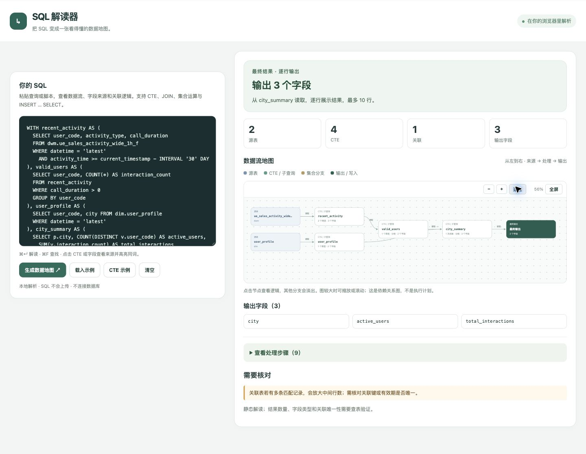
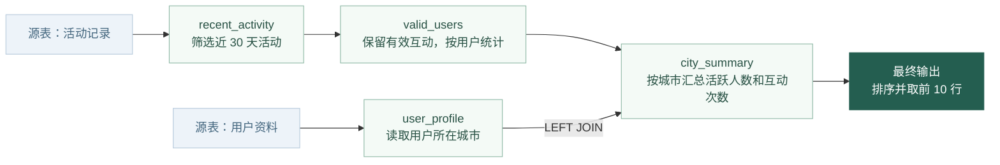
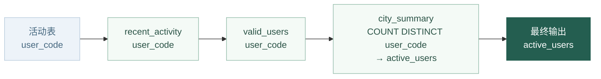

# SQL 解读器 · SQL Translator

把 SQL 变成一张看得懂的数据地图。

这是一个在浏览器里运行的 SQL 结构解读工具。粘贴一段 SQL，就能看到数据来自哪些表、经过哪些 CTE 和关联处理，以及输出字段如何追溯到上游。

适合接手长 SQL、梳理指标口径、检查关联条件，或向同事解释查询逻辑。项目名中的 Translator 指的是把 SQL 转成图和说明；当前提供的是结构解读，没有 SQL 方言转换功能。

**SQL 在本地浏览器中解析，不上传、不连接数据库，也不执行查询或写入语句。**

## 页面长什么样



左侧保留 SQL 编辑器，右侧先展示结构概览和数据流地图。点击节点或字段，再展开对应的处理逻辑和来源。

## 它怎么帮助你读懂 SQL

### 先看整条数据链路

例如，一段查询读取活动记录和用户资料，计算每个城市的活跃人数。原本分散在 SQL 中的步骤，可以归纳成下面的关系：



这与页面里的「CTE 示例」对应。图上的箭头表示数据依赖关系；数据库的实际执行顺序、并行方式和耗时，需要查看执行计划。

### 再追一个字段的来源

点击最终输出中的 `active_users`，可以沿着 CTE 继续追到原始字段：



来源图会合并共用路径，并保留集合分支。表达式和完整来源路径可以在详情中查看；如果字段缺少别名、来源有歧义，工具会提示需要核对，而不会凭空确定源表。

## 主要功能

| 功能 | 可以看到什么 | 怎么操作 |
| --- | --- | --- |
| 结构概览 | 源表、CTE、关联和输出字段数量 | 点击「生成数据地图」 |
| 数据流地图 | 源表 → CTE / 子查询 → 最终输出 → 写入目标 | 点击节点突出上下游，查看详情 |
| 字段来源图 | 输出字段经过哪些中间字段，来自哪里 | 点击输出字段或 SQL 中的字段 |
| 处理逻辑 | 筛选条件、关联键、分组、排序和行数限制 | 点击查询节点，或展开处理步骤 |
| JOIN 示意 | INNER、LEFT、RIGHT、FULL 等关联的记录保留规则 | 在节点详情或处理步骤中查看 |
| 大图浏览 | 复杂查询的多层依赖和集合分支 | 缩放、适应画布、全屏或滚动 |
| 编辑器联动 | 同词高亮、文本查找和匹配跳转 | 点击字段 / CTE，或使用快捷键 |

JOIN 图示表达的是记录保留规则，不代表实际匹配比例或行数。

## 本地启动

需要 Git 和 Python 3。页面本身不需要安装前端依赖。

```bash
git clone https://github.com/Alan0124/sql-translator.git
cd sql-translator
python3 -m http.server 8765 --bind 127.0.0.1
```

在浏览器中打开 [http://localhost:8765](http://localhost:8765)。

1. 点击「CTE 示例」体验多层数据流，或点击「载入示例」查看关联统计。
2. 换成自己的 SQL，点击「生成数据地图」。
3. 点击节点看本步逻辑，点击输出字段追溯来源。
4. 图较大时点击「全屏」；按 `Esc` 返回普通视图。

| 快捷键 | macOS | Windows / Linux |
| --- | --- | --- |
| 解读 SQL | `⌘ + Enter` | `Ctrl + Enter` |
| 查找文本 | `⌘ + F` | `Ctrl + F` |
| 下一个匹配 | 查找框内按 `Enter` | 查找框内按 `Enter` |
| 上一个匹配 | 查找框内按 `Shift + Enter` | 查找框内按 `Shift + Enter` |
| 关闭查找 / 退出全屏 | `Esc` | `Esc` |

## 支持范围与边界

当前使用规则解析器，覆盖项目样例中的常见结构，并非完整的 SQL 方言解析器。

| SQL 结构 | 当前能力 |
| --- | --- |
| `SELECT`、`WITH` CTE | 按查询作用域识别读取来源、输出字段和 CTE 依赖，支持嵌套同名 CTE 与 CTE 列名列表 |
| `JOIN`、`WHERE` | 拆解关联类型、条件和筛选条件 |
| `GROUP BY`、`HAVING`、`QUALIFY`、`ORDER BY`、`LIMIT` | 展示分组、后续筛选、排序与限制 |
| `CASE`、函数表达式 | 展示计算表达式，并追溯可识别的字段引用 |
| `UNION`、`UNION ALL`、`INTERSECT`、`EXCEPT` | 展示集合分支；按字段位置分析来源与集合关系 |
| `INSERT OVERWRITE / INTO … SELECT` | 展示写入目标和分区声明 |
| 前置 `ALTER TABLE … SET TBLPROPERTIES`、`%trino` / `%sql` | 展示脚本入口和表属性设置 |
| 部分子查询与 `LATERAL VIEW` | 展示来源子查询、`EXISTS` / `IN` 等筛选子查询及表达式子查询的依赖，识别样例中的展开结构 |

使用时需要留意：

- 不支持递归 CTE；一次输入只处理一条查询，可以带支持的前置表属性语句。
- 逗号连接、复杂方言或尚未覆盖的嵌套结构，可能无法完整拆解；请结合原 SQL 核对。
- `SELECT *` 只有在上游字段可从 SQL 中推导时才能展开；不会读取真实表结构。
- 支持省略 `AS` 的输出别名、双引号 / 反引号字段引用和常见窗口表达式；表达式子查询与跨层关联字段的完整血缘仍需结合子查询节点核对。
- 实际结果行数、字段类型、关联唯一性和数据质量，都需要另外查询数据库验证。
- 识别到 SQL 结构，不代表数据库一定可以执行这段 SQL。

## 项目结构

```text
sql-translator/
├── index.html              # 页面、编辑器和详情交互
├── parser.js               # SQL 结构解析与字段来源追溯
├── visual.js               # 依赖图构建、布局与 SVG 交互
├── test.mjs                # 解析和图形关系检查
├── fixtures/
│   └── fellow-eatv.sql      # 多层 CTE、关联和集合运算样例
└── docs/
    └── preview.jpg         # 页面截图
```

修改后可使用 Node.js 运行检查：

```bash
node test.mjs
node --check parser.js
node --check visual.js
git diff --check
```

检查覆盖常见查询、字段追溯、嵌套同名 CTE 的作用域、别名与窗口表达式、子查询依赖、CTE 列名列表、集合分支、写入目标，以及依赖连线的方向。重复引用上游字段的回归检查通过表达式读取次数验证缓存，避免依赖机器性能的耗时阈值。
